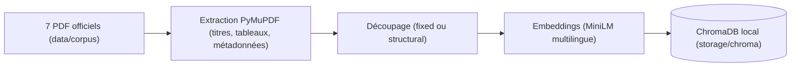
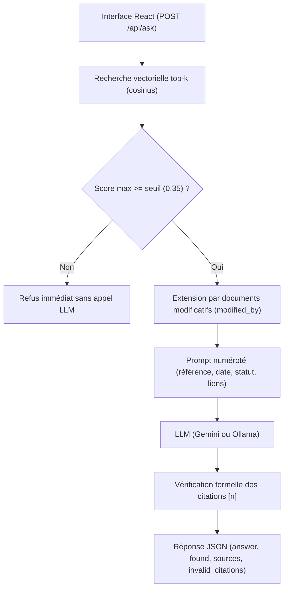

# Assistant Scolarité — RAG pour l'École d'Ingénieurs Hélianthe (EIH)

Application web de recherche augmentée par génération (RAG) qui répond aux questions des étudiants **uniquement à partir des 7 documents officiels de l'École**. Chaque affirmation est sourcée (`[1]`, `[2]`), les questions hors corpus reçoivent le refus exact « *Je ne trouve pas cette information dans les documents de l'École.* » sans hallucination, et en cas de contradiction entre deux textes, le document le plus récent qui se déclare modificatif l'emporte.

Projet du module RAG (3ACINFO, Université Mundiapolis) — binôme : **Zeineb Bouzerda** et **Maroua Abid**.

## Aperçu de l'interface

L'interface React (`frontend/`) s'organise autour d'une page d'accueil institutionnelle (Université Mundiapolis) et d'un espace de travail en trois onglets :

- **Page d'accueil** : présente le projet, un aperçu interactif de trois scénarios réels (conflit de version, citation exacte, refus hors corpus), les domaines de scolarité couverts et le corpus officiel.
- **Conversation** : chat avec filtre par type de document, réglage `top_k`, pastilles de citations cliquables et panneau latéral **Sources** synchronisé.
- **Documents** : liste des documents indexés, métadonnées, liens `modifie / modifié par` et réindexation idempotente.
- **Recherche** : mode débogage qui affiche les fragments bruts et leurs scores cosinus sans appeler le LLM.

## Architecture

Le système sépare l'ingestion hors ligne (indexation des PDF dans ChromaDB) du pipeline temps réel exécuté à chaque question.

### Ingestion hors ligne (une fois)



### Pipeline de réponse (à chaque requête)



### Organisation du projet

Le dépôt regroupe les composants principaux dans les dossiers suivants :

| Dossier / fichier | Rôle |
| --- | --- |
| `backend/` | API FastAPI, services RAG (`extraction`, `chunking`, `embeddings`, `vector_store`, `retrieval`, `generation`, `llm`) et 21 tests `pytest`. |
| `frontend/` | Interface React + TypeScript + Vite (page d'accueil Université Mundiapolis et espace de travail). |
| `start/` | Scripts de lancement en un clic pour Windows (`start_windows.bat`) et Linux/macOS (`start_linux.sh`). |
| `data/` | Les 7 PDF officiels (`corpus/`) et les exports JSON de la séance 1 (`processed/`). |
| `eval/` | Jeu de 21 questions annotées (`questions.jsonl`) et script d'évaluation (`run_eval.py`). |
| `scripts/` | Utilitaires de diagnostic (`check_gemini.py`, `debug_extraction.py`, `verify_json.py`). |
| `docs/` | Plan de travail, journal des changements, trame du rapport, soutenance et déclaration IA. |

## Installation

Prérequis : **Python 3.11 à 3.13** (recommandé : 3.12), **Node.js 18+ ou 20+ LTS** et une clé API **Gemini** (ou **Ollama** en local).

### 1. Installer le backend Python

Sous **Windows 10 / 11 (Command Prompt `cmd`)** :

```bat
python -m venv .venv
.venv\Scripts\activate.bat
python -m pip install --upgrade pip
pip install -r backend\requirements.txt
copy .env.example .env
```

<!-- prettier-ignore -->
> [!TIP]
> Sous Windows, créez toujours `.venv` à la racine du projet et utilisez `cmd` (`.venv\Scripts\activate.bat`). Si vous utilisez PowerShell et que `Activate.ps1` est bloqué, exécutez une fois `Set-ExecutionPolicy -Scope CurrentUser RemoteSigned`. Installer `torch` hors `.venv` dans Microsoft Store Python peut déclencher une erreur de chemin trop long (> 260 caractères).

Sous **Linux / macOS** :

```bash
python3 -m venv .venv
source .venv/bin/activate
pip install -r backend/requirements.txt
cp .env.example .env
```

### 2. Configurer `.env`

Ouvrez `.env` à la racine du projet et renseignez votre clé API sans guillemets ni espaces autour de `=`, avec un modèle actif comme `gemini-3.5-flash-lite` :

```env
LLM_PROVIDER=gemini
GEMINI_API_KEY=votre_cle_api_gemini
GEMINI_MODEL=gemini-3.5-flash-lite
```

<!-- prettier-ignore -->
> [!IMPORTANT]
> Le fichier `.env` n'est **jamais** versionné (voir `.gitignore`). La clé API reste strictement côté backend et n'est jamais exposée au navigateur.

Vérifiez la connexion au modèle Gemini :

```bash
python scripts/check_gemini.py
```

### 3. Installer le frontend

```bash
cd frontend
cp .env.example .env    # sous Windows : copy .env.example .env
npm install
cd ..
```

### Variables d'environnement

Les principaux paramètres du backend sont configurables dans `.env` à la racine :

| Variable | Rôle | Défaut |
| --- | --- | --- |
| `LLM_PROVIDER` | `gemini`, `ollama` ou `fake` (tests) | `gemini` |
| `GEMINI_API_KEY`, `GEMINI_MODEL` | Accès Gemini (recommandé : `gemini-3.5-flash-lite`) | — / `gemini-2.5-flash` |
| `OLLAMA_URL`, `OLLAMA_MODEL` | Alternative 100 % locale | `http://localhost:11434` / `mistral` |
| `SIMILARITY_THRESHOLD` | Score minimal du meilleur fragment, sinon refus sans LLM | `0.35` (**à calibrer**) |
| `EMBEDDING_MODEL` | Modèle d'embeddings multilingue | `paraphrase-multilingual-MiniLM-L12-v2` |
| `EMBEDDING_MAX_SEQ_LENGTH` | Tokens encodés par fragment | `384` |
| `CORS_ORIGINS` | Origines autorisées par FastAPI | `http://localhost:5173,http://127.0.0.1:5173` |

Côté frontend, `frontend/.env` contient uniquement `VITE_API_URL=http://localhost:8000`.

## Lancement

Une fois l'installation terminée, démarrez l'ensemble du projet avec les scripts de `start/` ou manuellement dans deux terminaux.

### Lancement rapide (recommandé)

Les scripts vérifient `.venv`, créent les `.env` manquants, lancent l'indexation initiale si `storage/chroma` n'existe pas encore, puis démarrent l'API et le frontend ensemble :

- **Windows 10 / 11** : double-cliquez sur `start\start_windows.bat` ou lancez :
  ```bat
  start\start_windows.bat
  ```
- **Linux / macOS** :
  ```bash
  ./start/start_linux.sh
  ```

### Lancement manuel (2 terminaux)

1. **Indexer le corpus** (une seule fois ; télécharge le modèle d'embeddings ~470 Mo la première fois) :
   ```bash
   python ingest_corpus.py --strategy structural
   ```
2. **Démarrer l'API** (`http://localhost:8000/docs`) :
   ```bash
   uvicorn backend.app.main:app --reload
   ```
3. **Démarrer l'interface** (`http://localhost:5173`) :
   ```bash
   cd frontend && npm run dev
   ```

<!-- prettier-ignore -->
> [!NOTE]
> La première question après le démarrage du serveur prend généralement 5 à 15 secondes sur CPU : le modèle d'embeddings est chargé à la demande afin de garder le démarrage de l'API rapide. Les questions suivantes répondent en 1 à 4 secondes. Après toute modification de `.env`, redémarrez `uvicorn` (`Ctrl+C` puis relance) car la configuration est mise en cache au démarrage.

## API REST

Toutes les routes sont préfixées par `/api` et documentées de manière interactive sur `/docs`.

| Route | Rôle | Erreurs |
| --- | --- | --- |
| `GET /api/health` | État du service et nombre de fragments indexés | `503` si la base est indisponible |
| `POST /api/ingest` | (Ré)indexation idempotente (`strategy`, `chunk_size`, `chunk_overlap`) | `404` corpus absent ; `422` si invalides |
| `GET /api/documents` | Documents indexés, métadonnées et liens de modification | `503` si la base est indisponible |
| `POST /api/search` | Recherche seule, fragments et scores cosinus | `422` si question vide |
| `POST /api/ask` | Recherche puis génération avec citations vérifiées | `422` ; `502` si le LLM ne répond pas |

## Tests et évaluation

Les 21 tests `pytest` tournent hors ligne (sans clé API ni réseau) grâce à `HashEmbeddingService` et `FakeLLM`.

```bash
pytest -v                                             # 21 tests backend, sans réseau
python eval/run_eval.py --check-gold                  # vérifie le jeu de test contre le corpus
python eval/run_eval.py --configs fixed:500:100:3 fixed:500:100:8 structural:1000:100:3 structural:1000:100:8 --sweep
python eval/run_eval.py --configs fixed:500:100:5 structural:1000:100:5 --generate
python scripts/verify_json.py                         # valide les JSON de la séance 1
cd frontend && npm run build                          # vérifie TypeScript et le build Vite
```

Détails des métriques et de la lecture des résultats : `docs/PLAN_TRAVAIL.md`.

## Choix techniques

Les choix suivants répondent directement aux contraintes des documents réglementaires du corpus :

- **PyMuPDF** : fournit la police et la taille de chaque ligne, permettant de détecter les titres *sans règle propre à ce corpus*. Les cellules de tableaux sont relues par géométrie (`get_text(clip=...)`) pour préserver les espaces.
- **Découpage structurel** : un fragment par article, section ou paire Q-R avec son chemin hiérarchique (`Titre III > Article 6`) ; une ligne de tableau n'est jamais coupée et garde ses en-têtes.
- **Versions** : le champ *Statut* de la fiche d'un document crée automatiquement les liens `modifie / modifié par`. Les fragments d'un texte modificatif sont ajoutés au contexte avec leur référence et leur date.
- **Ingestion idempotente** : les fragments de chaque fichier sont *remplacés*, jamais ajoutés ; changer de stratégie ne laisse aucun doublon.
- **Deux garde-fous côté code** : seuil de score (refus sans appel LLM) et vérification que chaque `[n]` cité correspond bien à un fragment fourni.

## Dépannage

<details>
<summary>Erreurs fréquentes sous Windows et avec Gemini</summary>

- **Erreur `404 NOT_FOUND` sur `gemini-2.5-flash`** : ce modèle est déprécié pour les nouvelles clés API. Passez à `GEMINI_MODEL=gemini-3.5-flash-lite` (ou `gemini-3.7-flash`) dans `.env`, puis redémarrez `uvicorn`.
- **Erreur `503 UNAVAILABLE` (forte demande Gemini)** : surcharge temporaire côté Google. Réessayez quelques secondes plus tard, changez vers `gemini-3.5-flash-lite`, ou basculez en local avec `LLM_PROVIDER=ollama` et `OLLAMA_MODEL=mistral`.
- **`Activate.ps1` bloqué sous PowerShell** : utilisez Command Prompt (`cmd`) avec `.venv\Scripts\activate.bat`, ou exécutez `Set-ExecutionPolicy -Scope CurrentUser RemoteSigned`.
- **Erreur `OSError: [Errno 2] ... torch` sous Windows** : causée par la limite de 260 caractères hors `.venv`. Créez `.venv` dans le projet (`python -m venv .venv`) puis activez-le avant `pip install`.
- **Badge « API injoignable » dans le frontend** : vérifiez que le backend tourne bien sur `http://localhost:8000` (`uvicorn backend.app.main:app --reload`) et que `frontend/.env` pointe vers `VITE_API_URL=http://localhost:8000`.

</details>

## Limites connues

Chaque question est indépendante (pas de mémoire de conversation) ; le seuil de score dépend du modèle d'embeddings ; le LLM peut occasionnellement mal appliquer une règle de précédence malgré le prompt ; les citations sont vérifiées *formellement* (le numéro existe), pas *sémantiquement*.
